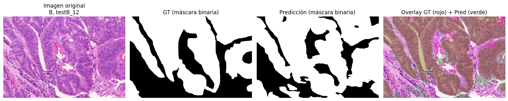

# GlandNet – gland segmentation in colon histology (GlaS)

U-Net family for **gland instance segmentation** on the GlaS (Warwick-QU) colon-histology challenge dataset
(85 train / 60 test-A / 20 test-B images), with iterative improvements and watershed post-processing.



## Approach
| Iteration | Change |
|---|---|
| v1 | U-Net 3 levels + **Tversky loss** + watershed to split touching glands |
| v1.1 | + **edge-weighted BCE** |
| v2 | U-Net **4 levels, multi-channel output (interior + border)** |
| v2.1 | border weighting (`border8`), tuned min-size / watershed footprint |

Metrics: pixel **Dice**, **Hausdorff distance** and **object-level F1** (matching predicted vs. ground-truth glands).

## Results (segmentation, from the notebook run)

| Subset | Dice | Hausdorff | Object F1 |
|---|---|---|---|
| Validation (20 % of train) | 0.879 | 45.8 | 0.735 |
| Test A | 0.855 | 45.5 | 0.529 |
| Test B | 0.780 | 42.4 | 0.456 |

**Caveats – please read**
- Post-processing hyper-parameters (probability threshold, min object size, watershed footprint) were selected *per test subset*
  in the notebook, so the Test A/B numbers are optimistic.
- Object-level F1 is clearly lower than pixel Dice: touching glands are still the main failure mode.

## Benign / malignant classifier (corrected)

The notebook's original EfficientNet-B0 classifier (and its heat-map/report cells, now deleted from the notebook) was **invalid**: it used
test-A = benign / test-B = malignant as labels (both subsets contain both grades) and was trained and evaluated on the same test images.
The corrected version is `classifier/train_gland_classifier.py`:

- Labels = image-level grade from `Grade.csv`, applied to every gland (**weak labels**: GlaS does not grade individual glands).
- Trained on the **train split only** (765 gland crops from GT masks). Fixed protocol: 12 epochs, threshold 0.5 — nothing tuned on test.
- Validation: 5-fold `StratifiedGroupKFold` grouped by patient; predictions pooled out-of-fold (folds are very uneven because a few patients have many images).
- Image prediction = mean gland probability. Test evaluated once, in two settings: ground-truth gland masks, and the **full pipeline** (U-Net predicted glands).

| Setting | Images | Image AUC (95 % bootstrap CI) | Image acc. | Gland AUC |
|---|---|---|---|---|
| Cross-validation, train (out-of-fold) | 85 | 0.962 (0.916–0.994) | 0.92 | 0.876 |
| Test A+B · GT masks | 80 | 0.999 (0.996–1.0) | 0.975 | 0.968 |
| Test A+B · predicted masks (full pipeline) | 80 | 0.991 (0.973–1.0) | 0.863 | 0.882 |
| Test A · predicted | 60 | 0.998 | 0.85 | 0.881 |
| Test B · predicted | 20 | 0.969 (0.859–1.0) | 0.90 | 0.827 |

**How to read this**
- **Likely optimistic.** 11 patients appear in both train and test (this is how GlaS is split), so the model may partly recognise patient-specific
  tissue. Test sets are tiny (60 and 20 images). Image-level numbers near 1.0 should not be read as clinical-grade performance.
- With predicted masks the *ranking* of images stays excellent (AUC 0.99) but accuracy drops to 0.86 at the fixed 0.5 threshold:
  the U-Net over-segments (2,183 predicted glands vs. 753 ground-truth), and benign images end up with mean probabilities just under 0.5.
  No threshold was tuned on test, so this is reported as-is.
- Gland-level metrics are against the weak image-level label and are therefore a lower bound on true gland-level accuracy.

Outputs (per-gland and per-image predictions, `metrics.json`, run log) are in `results/`. Run it with:
```bash
python classifier/train_gland_classifier.py --data-root data --pred-dir predictions_unet4L --out results --epochs 12 --ckpt models/gland_classifier_effb0.pth
```
`--pred-dir` needs the `<name>_labels_ws.npy` instance masks written by the segmentation notebook's inference cell.

## Repo layout
- `notebooks/01_glandnet2_segmentation_pipeline.ipynb` – segmentation training, evaluation, inference, reporting (classifier cells removed, see above).
- `classifier/train_gland_classifier.py` – corrected benign/malignant classifier.
- `results/` – classifier metrics and predictions.
- `notebooks/exploratory/02_deep_features_efficientnet.ipynb` – early deep-feature experiments.

## Data
Download GlaS from the Warwick-QU challenge page and place under `data/` (`train`, `test`, `Grade.csv`). The dataset is not redistributed here.

> **Note:** originally developed and run in Google Colab. Google-Drive mounting cells were removed, Drive paths were rewritten as relative paths and outputs were stripped (figures of the original run are in `assets/`). The paths/cleanup were **not re-executed** after this change, so expect to adjust paths.

## Author
Tiago Alejo Herrador
