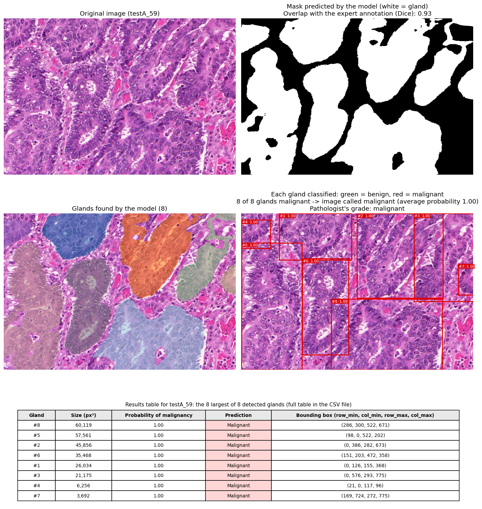
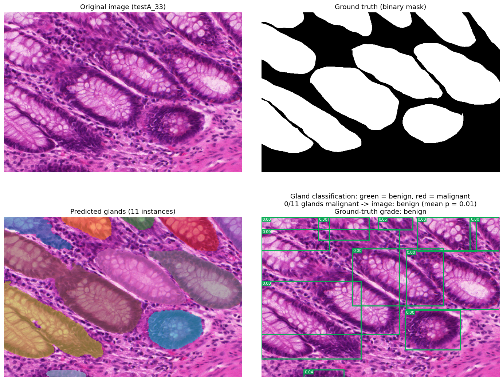
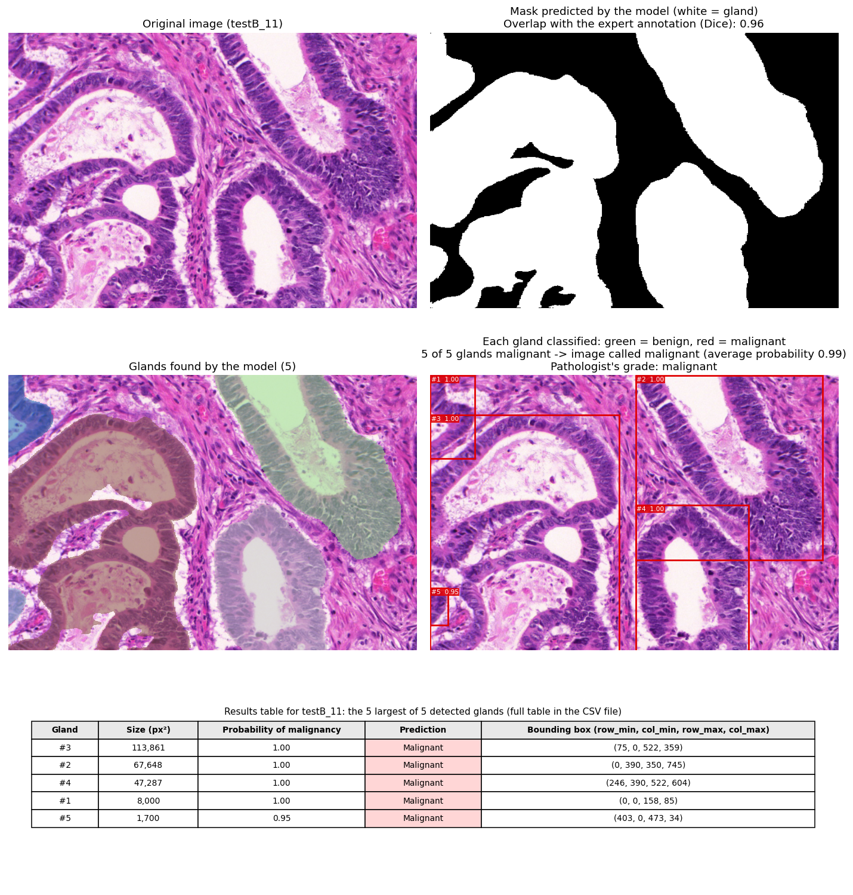
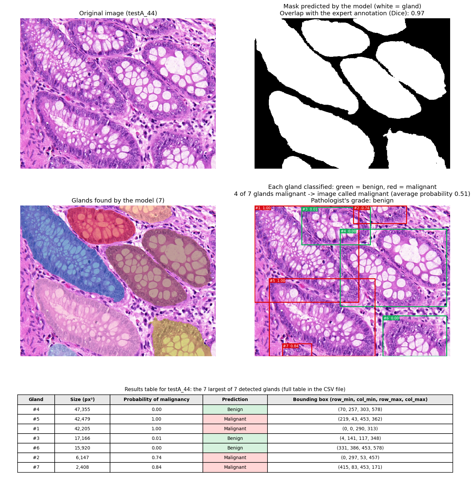
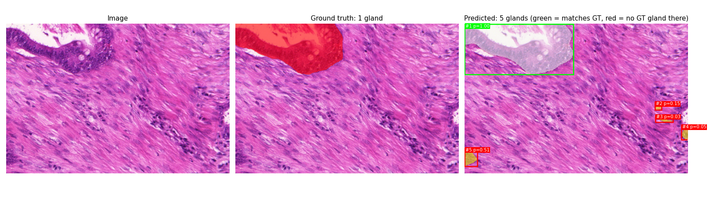
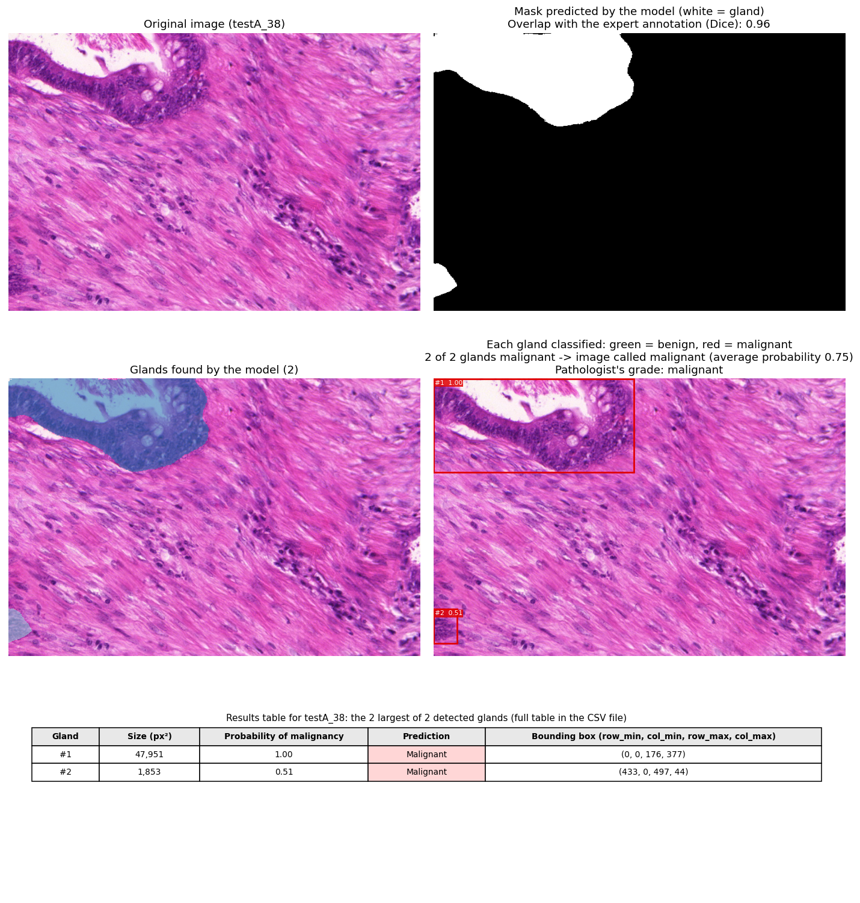
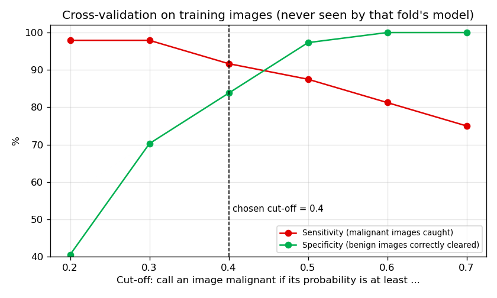

# GlandNet – teaching a computer to spot glands in colon tissue, and to flag the suspicious ones

[](https://github.com/tiagoherrador/glandnet-gland-segmentation/actions)

> **Research and portfolio project — not a medical device.** It has never been tested on real patients and must not be used to diagnose anything.

## The idea in plain words

When a doctor suspects colon cancer, a pathologist looks at a thin slice of tissue under the microscope. The first thing they check is the **glands**:
small tube-shaped structures that line the colon. In healthy tissue they look orderly; in cancer they become crowded, irregular and distorted.

This project automates that first look in two steps:

1. **Find the glands.** A neural network (a *U-Net*) outlines every gland in the picture.
2. **Judge each gland.** A second network looks at each gland on its own and estimates how likely it is to be malignant.

The result is an annotated picture, a results table, and a verdict for the whole image — all in one go.

## What the model gives you

For every tissue image you get **a figure** and **a table**.



*How to read the figure.* Top row: the original image and **the gland mask the model predicts** (white = gland). If the image comes with an expert's hand-drawn outline, the title also shows how closely the two overlap (Dice); with a new, unannotated image that line simply isn't there. Middle row, left: the glands the model found, each in its own colour.
Middle row, right: each gland in a box — **green means the model thinks it is benign, red means it thinks it is malignant** — with the gland's number and its probability of malignancy.
The image gets one overall verdict: the average of all its glands (and, when the dataset provides it, the pathologist's grade for comparison). Bottom: a table with the numbers behind every box.

The same table is saved as a spreadsheet (`results/examples/<image>_glands.csv`), so you can use it without opening the picture:

| gland | size (px²) | bounding box (row_min, col_min, row_max, col_max) | probability malignant | prediction |
|---|---|---|---|---|
| 8 | 60,119 | (286, 300, 522, 671) | 1.00 | malignant |
| 5 | 57,561 | (98, 0, 522, 202) | 1.00 | malignant |
| … | … | … | … | … |

And `results/examples/summary.csv` has one line per image — how many glands were found, how many were called malignant and the image verdict. For images that come with a pathologist's grade, it also says whether the model got it right (otherwise those columns are left empty):

| image | glands found | called malignant | verdict | pathologist's grade | correct? |
|---|---|---|---|---|---|
| testA_33 | 11 | 0 | benign | benign | yes |
| testA_59 | 8 | 8 | malignant | malignant | yes |
| testB_11 | 5 | 5 | malignant | malignant | yes |
| testA_44 | 7 | 4 | malignant | benign | **no** (false alarm) |
| testA_38 | 2 | 2 | malignant | malignant | yes (see below) |

More examples — a healthy image and a malignant one from the second test set:

| Healthy tissue, correctly called benign | Malignant tissue, correctly called malignant |
|---|---|
|  |  |

### When it gets it wrong
Out of the 80 test images, **1 is wrong: a false alarm. No malignant image was missed** (with the cautious cut-off and the minimum gland size described below).

`testA_44` is benign, but the model calls it malignant. The glands were found correctly — the mistake is in judging them: the model marks several large, elongated glands as malignant.



### A mistake we found and fixed: tiny detections
`testA_38` is malignant and has a single real gland, which the model classified as malignant with probability 1.00. But the model also marked four small patches of connective tissue as "glands", and averaging them in pulled the image verdict below the cut-off — a cancer missed because of detections that were not glands.
We now ignore detections smaller than 1,000 pixels (about 0.4 % of the image); see [why and how the value was chosen](docs/min_gland_size.md), including the peer-reviewed literature behind the idea.

| Before (5 detections, 1 real gland) | After the minimum-size filter |
|---|---|
|  |  |

## How well does it work?

All numbers below are on images the model **never saw during training** (the 80 test images of the public GlaS challenge dataset).

### Finding the glands
| Test set | How well the outlines match the experts' (Dice) | How many individual glands were correctly found (F1) |
|---|---|---|
| Set A (60 images: 33 benign, 27 malignant) | **0.89** | **0.88** |
| Set B (20 images: 16 malignant, 4 benign — harder) | 0.81 | 0.80 |

### Judging the glands
| | Ranks malignant above benign (AUC) | Malignant images caught | Benign images correctly cleared | Images called correctly |
|---|---|---|---|---|
| During development (cross-validation on training images) | 0.96 | 92 % (44 of 48) | 84 % (31 of 37) | 88 % |
| Test images, glands found by the model | **1.00** | **100 %** (43 of 43) | **97 %** (36 of 37) | **99 %** (79 of 80) |

The "images called correctly" use the cut-off of 0.4 (below). **Read the test row with caution:** an AUC of 1.00 on 80 images, with some patients present in both training and test, is a sign of an easy benchmark more than of clinical-grade performance. The development row (cross-validation) is the more realistic preview.

**What the metrics mean**
- **Dice (0 to 1)** — how much the model's outline overlaps the experts' outline. 1 is a perfect copy; 0.9 is very close.
- **F1 (0 to 1)** — counts glands one by one: did the model find this gland, and did it avoid inventing ones that aren't there? It is stricter than Dice because a missed or merged gland hurts.
- **AUC (0.5 to 1)** — if you pick one malignant and one benign image at random, how often does the model give the malignant one the higher score? 0.5 is a coin flip, 1.0 is always right.
- **Sensitivity** — of all the malignant images, the share the model catches. *Missing a cancer is the costly mistake, so this is the number we care most about.*
- **Specificity** — of all the benign images, the share the model correctly clears. When it is low, healthy images get flagged and someone has to double-check them.

## Why the cut-off is 0.4 and not 0.5

The model gives each gland (and each image) a probability of being malignant, and we have to decide above which probability we raise a flag. The usual choice is 0.5. **We use 0.4 on purpose**, because the two kinds of mistakes are not equally serious:

- a **missed cancer** (false negative) can delay a diagnosis and its treatment;
- a **false alarm** (false positive) only means a pathologist takes another look.

So we would rather flag a little too much than miss something. A lower cut-off makes the model more suspicious:



In cross-validation, going from 0.5 to 0.4 catches **2 more cancers out of 48** at the price of **5 more false alarms out of 37 healthy images**. It reduces missed cancers; it does not eliminate them. (On the test images, after small detections are discarded, 0.4 and 0.5 give the same result; the trade-off is clearest in cross-validation.)
Full numbers, the honest caveats and how to change the cut-off are in **[docs/decision_threshold.md](docs/decision_threshold.md)**.

## Things to keep in mind (honest limits)

- **The score looks better than it should.** In this public dataset, 11 patients contribute images to both the training and the test sets. The model may partly be recognising *that patient's tissue* rather than learning what malignancy looks like. Treat the AUC near 1.0 with caution.
- **Small test sets.** 60 and 20 images are few; a couple of mistakes move the numbers noticeably.
- **The "malignant / benign" label is for the whole image, not each gland.** The dataset only says whether an image is benign or malignant, so every gland in a malignant image is trained as "malignant", even if some of them look normal. That is why individual glands are judged less accurately than whole images (in cross-validation: AUC 0.88 per gland vs 0.96 per image).
- **Neighbouring glands that touch can merge** into one big blob, which lowers the gland-by-gland score (F1).
- **Tiny detections are ignored on purpose.** Regions under 1,000 pixels are discarded because they are mostly spurious; this also means a few genuinely small glands can be lost, and some spurious ones still get through (24 on the test set). See [docs/min_gland_size.md](docs/min_gland_size.md).
- **The 0.4 cut-off was a judgement call**, chosen to favour catching cancers (see above). Because it was picked after seeing earlier test results, the test numbers are somewhat optimistic; the cross-validation numbers are the fairer guide.
- **The image verdict is an average of its glands**, so a few very suspicious glands can be diluted by many normal ones.

## How it works (the short version)

1. **Outline.** The U-Net predicts, for every pixel, "is this gland?" and "is this a gland border?"; the two are combined into one gland map. Pixels above a probability threshold form the gland mask, and each separate connected region is counted as one gland. **Regions smaller than about 0.4 % of the image are discarded** as spurious detections ([why](docs/min_gland_size.md)). The threshold and the minimum size were chosen on a validation set, never on the test set.
2. **Crop.** Each gland is cut out with a small margin.
3. **Judge.** An EfficientNet-B0 network (pre-trained on everyday photos, then trained on gland crops) gives each crop a probability of being malignant. The image verdict is the average over its glands.

## Get the trained models and try them

### 1. Ask for the models
The trained models are shared **on request**. Send an email to **tiago.alejo.h@hotmail.com** with the subject *"GlandNet models"* and a line about how you plan to use them.
You will receive a package (about 140 MB) with the two model files, checksums to verify them, and short instructions. They are shared for research and evaluation purposes.

### 2. Run them on your own images
```bash
pip install -e .
# copy the two model files into models/   (names: unet4l.pth and gland_classifier_effb0.pth)

glandnet-predict --images my_slide.png            # one image
glandnet-predict --images folder_with_slides/     # or a whole folder
```
For every image you get the **figure** shown above, a **table with one row per gland** (`<image>_glands.csv`) and a `summary.csv` with the verdict per image — in the `predictions/` folder.
No annotations or datasets are needed. Use `--threshold` to change the malignancy cut-off (default 0.4, see [why](#why-the-cut-off-is-04-and-not-05)).

### Not ready to ask? See the outputs first
The figures above come from the model, and the matching tables are in [`results/examples/`](results/examples) (one CSV per image plus `summary.csv`).

**Data used:** the *GlaS* challenge dataset (Warwick-QU, 165 colon-tissue images with expert outlines). It is not included here; it is available from the challenge page.

<details>
<summary><b>For developers</b></summary>

*Training and evaluation code is included for transparency; you do not need it to use the models. Tests: `pytest -q` (35 tests).*

**Code layout** (`src/glandnet/`): `model.py` (4-level U-Net, 2 output channels) · `losses.py` (border-weighted BCE + Dice + Tversky) · `postprocess.py` (threshold → remove small objects → connected-component glands) ·
`metrics.py` (pixel and object-level metrics) · `predict.py` (the `glandnet-predict` command) · `data.py` (GlaS loading, reproducible 80/20 split) · `train.py` · `evaluate.py` · `classifier.py` (EfficientNet-B0 on gland crops, patient-grouped CV) · `visualize.py` (figures and tables).

**Segmentation protocol.** Post-processing parameters (probability threshold, minimum object size) are chosen by grid search on the 17-image validation split (selected: threshold 0.65, **minimum size 1,000 px at 512 × 512**; the watershed footprint is fixed at 22 because it does not change the mask) and applied unchanged to test. Rationale and references: [docs/min_gland_size.md](docs/min_gland_size.md), [docs/references.md](docs/references.md).

| Split | Images | Object Dice | Object F1 | Pixel Dice | Hausdorff | Spurious detections |
|---|---|---|---|---|---|---|
| Validation | 17 | 0.894 | 0.886 | 0.926 | 33.7 | 5 of 161 |
| Test A | 60 | 0.886 | 0.878 | 0.914 | 36.8 | 18 of 542 |
| Test B | 20 | 0.805 | 0.796 | 0.891 | 40.8 | 6 of 104 |
| Test A+B | 80 | 0.866 | 0.858 | 0.908 | 37.8 | 24 of 646 |

For reference, the previous 25 px setting gave F1 0.755 and 133 spurious detections on test A+B (`test_reference_min_size_25` in `results/segmentation_metrics.json`). The full validation sweep is in `results/validation_sweep.csv`.

**Classifier protocol.** Labels from `Grade.csv` (image grade applied to each gland), trained on the train split only (765 gland crops), 5-fold `StratifiedGroupKFold` by patient with out-of-fold predictions pooled, 12 epochs.
An image is called malignant when the mean gland probability is ≥ `DECISION_THRESHOLD = 0.4` (see [docs/decision_threshold.md](docs/decision_threshold.md)). On test, glands are detected by the **full package pipeline** (U-Net with the validation-selected parameters → connected components → classifier).

| Setting | Images | Image AUC (95 % bootstrap CI) | Sensitivity | Specificity | Image acc. | Gland AUC |
|---|---|---|---|---|---|---|
| CV on train (out-of-fold) | 85 | 0.962 (0.916–0.994) | 91.7 % (44/48) | 83.8 % (31/37) | 0.882 | 0.876 |
| Test A+B · ground-truth glands | 80 | 0.999 (0.996–1.0) | 100 % (43/43) | 97.3 % (36/37) | 0.9875 | 0.968 |
| Test A+B · model-found glands (646 detected) | 80 | 1.000 (1.0–1.0) | 100 % (43/43) | 97.3 % (36/37) | 0.9875 | 0.968 |

Sweeps for other cut-offs: `results/threshold_sweep_oof.csv` (cross-validation) and `results/threshold_sweep_test_{gt,pred}.csv`.

**Design notes**
- *Glands are connected components.* The watershed step floods the whole mask, so it does not change which pixels are glands; counting, cropping and evaluating use connected components (`gland_instances`).
  Using the watershed ids as instances would cut large glands into many fragments (2,183 "glands" instead of 730). Making the watershed actually split touching glands is an open improvement.
- *Tuning on test is a leak.* An early version swept thresholds on test A/B and reported the best; the package selects on validation only.
- *A classifier needs real labels.* A first attempt used test-A = benign / test-B = malignant (wrong: both subsets contain both grades) and trained on test images; it was replaced by the `Grade.csv` version above.
- *Spurious detections.* Counting detections that lie outside the annotation showed that the first pipeline produced many tiny false "glands" (133 on the test set), which diluted the image-level average; a validation-selected minimum size fixed most of them (24 remain).
- The U-Net checkpoint was trained with the original notebook recipe (`notebooks/exploratory/`); `glandnet-train` is a refactor of it and has not been re-run end to end. The classifier is now evaluated through the package pipeline (validation-selected parameters), not on masks saved by the notebook; `--pred-dir` still accepts those legacy masks.
- *Choosing the cut-off.* 0.4 favours sensitivity on purpose and was a judgement call; the cross-validated trade-off is in `docs/decision_threshold.md`.
- Iteration path: U-Net 3 levels + Tversky → + edge-weighted BCE → 4 levels with a border channel (final).

</details>

## Author
Tiago Alejo Herrador — MIT licensed.
