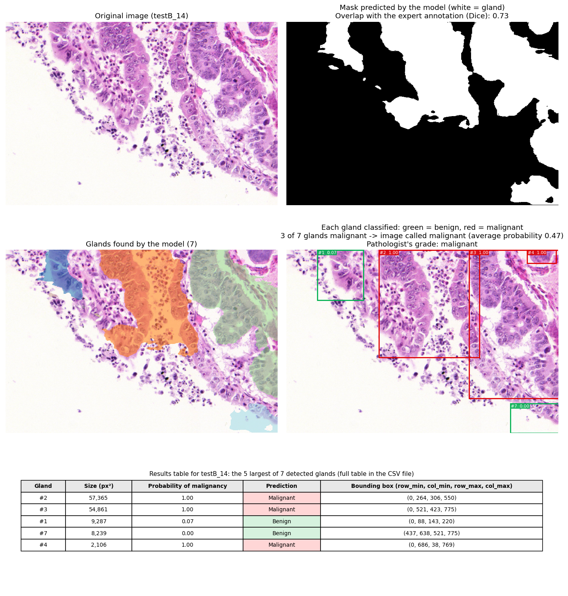

# GlandNet – teaching a computer to spot glands in colon tissue, and to flag the suspicious ones

[](https://github.com/tiagoherrador/glandnet-gland-segmentation/actions)

> **Research and portfolio project — not a medical device.** It has never been tested on real patients and must not be used to diagnose anything.

## The idea in plain words

When a doctor suspects colon cancer, a pathologist looks at a thin slice of tissue under the microscope. The first thing they check is the **glands**:
small tube-shaped structures that line the colon. In healthy tissue they look orderly; in cancer they become crowded, irregular and distorted.

This project automates that first look in two steps:

1. **Find the glands.** A neural network (a *U-Net*) outlines every gland in the picture.
2. **Judge each gland.** A second network looks at each gland on its own and estimates how likely it is to be malignant.

The result is an annotated picture, a results table, and a verdict for the whole image — all in one go.

## What the model gives you

For every tissue image you get **a figure** and **a table**.


*How to read the figure.* Top row: the original image and **the gland mask the model predicts** (white = gland). If the image comes with an expert's hand-drawn outline, the title also shows how closely the two overlap (Dice); with a new, unannotated image that line simply isn't there. Middle row, left: the glands the model found, each in its own colour.
Middle row, right: each gland in a box — **green means the model thinks it is benign, red means it thinks it is malignant** — with the gland's number and its probability of malignancy.
The image gets one overall verdict: the average of all its glands (and, when the dataset provides it, the pathologist's grade for comparison). Bottom: a table with the numbers behind every box.

The same table is saved as a spreadsheet (`results/examples/<image>_glands.csv`), so you can use it without opening the picture:

| gland | size (px²) | bounding box (row_min, col_min, row_max, col_max) | probability malignant | prediction |
|---|---|---|---|---|
| 2 | 26,034 | (0, 126, 155, 368) | 1.00 | malignant |
| 3 | 45,856 | (0, 386, 282, 673) | 1.00 | malignant |
| … | … | … | … | … |

And `results/examples/summary.csv` has one line per image — how many glands were found, how many were called malignant and the image verdict. For images that come with a pathologist's grade, it also says whether the model got it right (otherwise those columns are left empty):

| image | glands found | called malignant | verdict | pathologist's grade | correct? |
|---|---|---|---|---|---|
| testA_33 | 11 | 0 | benign | benign | yes |
| testA_59 | 10 | 10 | malignant | malignant | yes |
| testB_11 | 6 | 5 | malignant | malignant | yes |
| testA_44 | 9 | 5 | malignant | benign | **no** (false alarm) |
| testB_14 | 7 | 3 | malignant | malignant | yes (a close call, see below) |
| testA_38 | 5 | 2 | benign | malignant | **no** (missed cancer) |

More examples — a healthy image and a malignant one from the second test set:

| Healthy tissue, correctly called benign | Malignant tissue, correctly called malignant |
|---|---|
|  |  |

### When it gets it wrong
With the cautious cut-off we use (see [why 0.4](#why-the-cut-off-is-04-and-not-05)), **3 of the 80 test images were wrong: 1 missed cancer and 2 false alarms.**

**A false alarm.** `testA_44` is benign, but the model calls it malignant. The glands were found correctly — the mistake is in judging them: the model marks two large, elongated glands as malignant.


**A missed cancer.** `testA_38` is malignant, but only 2 of its 5 glands are flagged and the image average (0.35) stays below the cut-off. This is the kind of error we most want to avoid.


**A close call that the cautious cut-off rescued.** In `testB_14`, three glands score 1.00 but the image average is only 0.47: with the usual 0.5 cut-off this cancer would have been missed; with 0.4 it is caught.



## How well does it work?

All numbers below are on images the model **never saw during training** (the 80 test images of the public GlaS challenge dataset).

### Finding the glands
| Test set | How well the outlines match the experts' (Dice) | How many individual glands were correctly found (F1) |
|---|---|---|
| Set A (60 images: 33 benign, 27 malignant) | **0.89** | **0.78** |
| Set B (20 images: 16 malignant, 4 benign — harder) | 0.81 | 0.69 |

### Judging the glands
| | Ranks malignant above benign (AUC) | Malignant images caught | Benign images correctly cleared | Images called correctly |
|---|---|---|---|---|
| During development (cross-validation on training images) | 0.96 | 92 % (44 of 48) | 84 % (31 of 37) | 88 % |
| Test images, glands found by the model | **0.995** | **98 %** (42 of 43) | **95 %** (35 of 37) | **96 %** (77 of 80) |

The "images called correctly" use the cut-off of 0.4 (below). The development row is the fairer preview of real-life performance: the test row is a bit flattering because we chose the cut-off after seeing earlier test results.

**What the metrics mean**
- **Dice (0 to 1)** — how much the model's outline overlaps the experts' outline. 1 is a perfect copy; 0.9 is very close.
- **F1 (0 to 1)** — counts glands one by one: did the model find this gland, and did it avoid inventing ones that aren't there? It is stricter than Dice because a missed or merged gland hurts.
- **AUC (0.5 to 1)** — if you pick one malignant and one benign image at random, how often does the model give the malignant one the higher score? 0.5 is a coin flip, 1.0 is always right.
- **Sensitivity** — of all the malignant images, the share the model catches. *Missing a cancer is the costly mistake, so this is the number we care most about.*
- **Specificity** — of all the benign images, the share the model correctly clears. When it is low, healthy images get flagged and someone has to double-check them.

## Why the cut-off is 0.4 and not 0.5

The model gives each gland (and each image) a probability of being malignant, and we have to decide above which probability we raise a flag. The usual choice is 0.5. **We use 0.4 on purpose**, because the two kinds of mistakes are not equally serious:

- a **missed cancer** (false negative) can delay a diagnosis and its treatment;
- a **false alarm** (false positive) only means a pathologist takes another look.

So we would rather flag a little too much than miss something. A lower cut-off makes the model more suspicious:


In cross-validation, going from 0.5 to 0.4 catches **2 more cancers out of 48** at the price of **5 more false alarms out of 37 healthy images**. It reduces missed cancers; it does not eliminate them.
Full numbers, the honest caveats and how to change the cut-off are in **[docs/decision_threshold.md](docs/decision_threshold.md)**.

## Things to keep in mind (honest limits)

- **The score looks better than it should.** In this public dataset, 11 patients contribute images to both the training and the test sets. The model may partly be recognising *that patient's tissue* rather than learning what malignancy looks like. Treat the AUC near 1.0 with caution.
- **Small test sets.** 60 and 20 images are few; a couple of mistakes move the numbers noticeably.
- **The "malignant / benign" label is for the whole image, not each gland.** The dataset only says whether an image is benign or malignant, so every gland in a malignant image is trained as "malignant", even if some of them look normal. That is why individual glands are judged less accurately (AUC 0.89) than whole images (0.99).
- **Neighbouring glands that touch can merge** into one big blob, which lowers the gland-by-gland score (F1).
- **The 0.4 cut-off was a judgement call**, chosen to favour catching cancers (see above). Because it was picked after seeing earlier test results, the test numbers are somewhat optimistic; the cross-validation numbers are the fairer guide.
- **The image verdict is an average of its glands**, so a few very suspicious glands can be diluted by many normal ones.

## How it works (the short version)

1. **Outline.** The U-Net predicts, for every pixel, "is this gland?" and "is this a gland border?"; the two are combined into one gland map. Pixels above a probability threshold form the gland mask, and each separate connected region is counted as one gland. The threshold and the cleaning settings were chosen on a validation set, never on the test set.
2. **Crop.** Each gland is cut out with a small margin.
3. **Judge.** An EfficientNet-B0 network (pre-trained on everyday photos, then trained on gland crops) gives each crop a probability of being malignant. The image verdict is the average over its glands.

## Try it yourself

```bash
pip install -e ".[train,dev]"
# download the GlaS dataset (link below) into data/{train,test}/{images,masks} and data/metadata/Grade.csv

glandnet-train     --data-root data --out-dir models        # 1. train the gland finder
glandnet-eval      --data-root data --checkpoint models/unet4l.pth   # 2. measure it
glandnet-classify  --data-root data --out results --seg-checkpoint models/unet4l.pth   # 3. train + test the benign-vs-malignant judge
glandnet-visualize --data-root data --seg-checkpoint models/unet4l.pth \
                   --cls-checkpoint models/gland_classifier_effb0.pth \
                   --names testA_59 testB_11 --out assets --tables results/examples   # 4. figures + tables
glandnet-visualize ... --images my_slide.png ...             # also works on any new image, no annotation needed
pytest -q                                                    # 30 automated tests
```

**Data:** the *GlaS* challenge dataset (Warwick-QU, 165 colon-tissue images with expert outlines). It is not included here; download it from the challenge page.
Model weights (`*.pth`) are also not included.

<details>
<summary><b>For developers</b></summary>

**Code layout** (`src/glandnet/`): `model.py` (4-level U-Net, 2 output channels) · `losses.py` (border-weighted BCE + Dice + Tversky) · `postprocess.py` (threshold → remove small objects → connected-component glands) ·
`metrics.py` (pixel and object-level metrics) · `data.py` (GlaS loading, reproducible 80/20 split) · `train.py` · `evaluate.py` · `classifier.py` (EfficientNet-B0 on gland crops, patient-grouped CV) · `visualize.py` (figures and tables).

**Segmentation protocol.** Post-processing parameters (threshold, minimum object size, watershed footprint) are chosen by grid search on the 17-image validation split (selected: 0.65 / 25 / 22) and applied unchanged to test.

| Split | Images | Object Dice | Object F1 | Pixel Dice | Hausdorff |
|---|---|---|---|---|---|
| Validation | 17 | 0.887 | 0.827 | 0.926 | 33.5 |
| Test A | 60 | 0.886 | 0.775 | 0.913 | 35.9 |
| Test B | 20 | 0.805 | 0.693 | 0.891 | 40.8 |
| Test A+B | 80 | 0.866 | 0.755 | 0.908 | 37.1 |

**Classifier protocol.** Labels from `Grade.csv` (image grade applied to each gland), trained on the train split only (765 gland crops), 5-fold `StratifiedGroupKFold` by patient with out-of-fold predictions pooled, 12 epochs.
An image is called malignant when the mean gland probability is ≥ `DECISION_THRESHOLD = 0.4` (see [docs/decision_threshold.md](docs/decision_threshold.md)). On test, glands are detected by the **full package pipeline** (U-Net with the validation-selected parameters → connected components → classifier).

| Setting | Images | Image AUC (95 % bootstrap CI) | Sensitivity | Specificity | Image acc. | Gland AUC |
|---|---|---|---|---|---|---|
| CV on train (out-of-fold) | 85 | 0.962 (0.916–0.994) | 91.7 % (44/48) | 83.8 % (31/37) | 0.882 | 0.876 |
| Test A+B · ground-truth glands | 80 | 0.999 (0.996–1.0) | 100 % (43/43) | 97.3 % (36/37) | 0.9875 | 0.968 |
| Test A+B · model-found glands (790 vs 753 true) | 80 | 0.995 (0.983–1.0) | 97.7 % (42/43) | 94.6 % (35/37) | 0.9625 | 0.917 |

Sweeps for other cut-offs: `results/threshold_sweep_oof.csv` (cross-validation) and `results/threshold_sweep_test_{gt,pred}.csv`.

**Design notes**
- *Glands are connected components.* The watershed step floods the whole mask, so it does not change which pixels are glands; counting, cropping and evaluating use connected components (`gland_instances`).
  Using the watershed ids as instances would cut large glands into many fragments (2,183 "glands" instead of 730). Making the watershed actually split touching glands is an open improvement.
- *Tuning on test is a leak.* An early version swept thresholds on test A/B and reported the best; the package selects on validation only.
- *A classifier needs real labels.* A first attempt used test-A = benign / test-B = malignant (wrong: both subsets contain both grades) and trained on test images; it was replaced by the `Grade.csv` version above.
- The U-Net checkpoint was trained with the original notebook recipe (`notebooks/exploratory/`); `glandnet-train` is a refactor of it and has not been re-run end to end. The classifier is now evaluated through the package pipeline (validation-selected parameters), not on masks saved by the notebook; `--pred-dir` still accepts those legacy masks.
- *Choosing the cut-off.* 0.4 favours sensitivity on purpose and was a judgement call; the cross-validated trade-off is in `docs/decision_threshold.md`.
- Iteration path: U-Net 3 levels + Tversky → + edge-weighted BCE → 4 levels with a border channel (final).

</details>

## Author
Tiago Alejo Herrador — MIT licensed.
